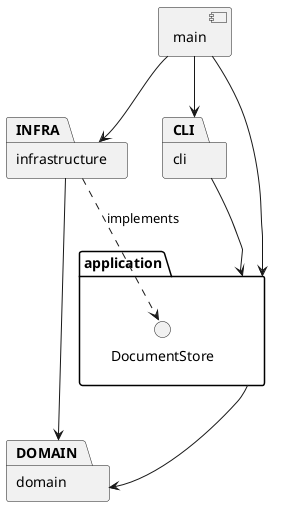

# Lab1 Phase 1：SVG 命令行编辑器

当前状态：已实现矩形、圆形、椭圆、线段、文字及其编辑、显示和撤销重做；已实现 g 容器、in 归属和递归显示；分组重排与文件读写仍待实现。

## 架构方案

### 模块划分

| 计划目录 | 职责 |
| --- | --- |
| src/cli | REPL、引号参数解析、命令分发与反馈 |
| src/application | 编辑器会话、命令执行、撤销重做历史 |
| src/application/commands | 各编辑命令类；一条编辑命令为一个撤销单元 |
| src/application/ports | 文档存取接口 |
| src/domain | 文档、唯一 id 索引、父子关系和树结构约束 |
| src/domain/shapes | 图形抽象、五种叶子图形与 Group |
| src/infrastructure | SVG XML 解析、序列化和文件读写 |
| src/main.ts | 程序入口和依赖组装 |

计划目录随实现创建，避免把空目录当成已实现模块。

### 设计模式的选择

- Command（必需）：编辑命令封装执行与撤销，历史管理器维护 undo/redo 栈。失败命令不入栈，不清除 redo，也不改变文档。
- Composite：叶子与 Group 提供统一操作接口，容器移动和缩放递归委托给子节点，避免命令层按图形类型分支。
- Factory：集中处理类型名到具体图形类的创建映射；SVG 导入复用工厂。
- Command 当前代码落点：
  src/application/commands/EditCommand.ts 定义命令契约；
  src/application/CommandHistory.ts 管理执行、撤销和重做；
  EditorSession 负责调用并在成功的文档操作后设置历史屏障。
  已实现 CreateShapeCommand、MoveCommand、ScaleCommand 、DeleteShapeCommand 和 SetAttributeCommand。
- Memento（轻量实现）：captureGeometry 返回恢复几何状态的闭包。
  状态由图形内部封装，MoveCommand 无需读取私有字段。
按名字分派仅允许命令分发与图形工厂两处；按实验要求列为待重构项，未来可替换为注册机制。本阶段不实现 box 或插件系统。

### 依赖方向规则

- cli 可以依赖 application；不直接操作文件系统或修改图形字段。
- application 可以依赖 domain；通过 ports 使用文档存取能力，不依赖 infrastructure。
- domain 不依赖 application、cli 或 infrastructure，不执行终端和文件 IO。
- infrastructure 可以依赖 application/ports 与 domain，实现外部存取。
- main 负责组装，可以依赖各模块。

以上规则将领域行为与输入输出隔离，便于测试和替换交互方式。

### 变化点假设

1. 交互方式可能增加 GUI 或 agent：保留 application 层供不同入口调用。
2. 图形类型可能增加：使用多态及集中工厂；暂不实现插件加载器，避免超出本阶段范围。
3. 文件存储方式可能变化：通过 DocumentStore 接口隔离。
4. 撤销实现可能优化：由命令保存恢复所需的状态；先保证精确恢复，不提前做压缩或持久化历史。

### 待确认语义

- 跨父级 group 的新组父级、插入位置及排序规则。
- 外部 SVG 的 transform 和未知标签支持范围。
- 显式 save 后，默认保存路径是否更新。
- 未初始化时 help 是否可用。
- 示例保存节点计数与实际结构不一致，需明确计数口径。

### 方案修订记录

- 2026-10-29：建立初版架构和工程骨架。
- ShapeFactory 实际放在 application 层，负责将命令参数转换为领域对象。
- 当前使用 Map 保存根级图形及顺序；引入容器时将拆分为全文档 id 索引
  和各容器的有序子节点。

## 过程记录

### 第一步：环境检查与工程初始化

- 实际检查：工作目录为空且未初始化 Git；Git 2.41.0、Node.js 16.19.1、npm 8.19.3 可用。
- AI 协作：先阅读实验要求，明确本阶段仅实现六种内置图形，不实现 box。
- 创建严格模式 TypeScript 工程，固定编译器版本，并将构建产物和依赖目录排除于 Git。
- 遇到的问题：npm 默认缓存目录无法写入，报 EPERM。
- 解决方式：通过项目级 .npmrc 将缓存设置为 ./.npm-cache，并在 .gitignore 中忽略缓存目录。
- 验证结果：npm install、npm run check、npm run cli 均成功，入口输出工程初始化提示。

### 第二步：实现基础 REPL

- 新增 src/cli/Repl.ts，封装终端输入循环；main.ts 负责启动。
- 支持 svg> 提示符、help、忽略空行与整行注释。
- 未知命令输出 error:，随后仍可继续输入命令。
- 安装 @types/node，配置 Node.js 类型定义。
- 将 module 和 moduleResolution 统一设置为 Node16，替换旧解析模式。
- 验证结果：npm run cli 编译成功；手动测试帮助、空行、注释、
  未知命令后继续交互及退出，均符合预期。
- 当前限制：help 仅列出已实现功能，完整命令帮助将在后续补齐。

### 第三步：参数解析与错误处理

- 新增 CommandParser 类，将命令行输入解析为参数数组。
- 支持双引号包裹的空格文本、空字符串、空行和整行注释。
- 保留命令中的十六进制颜色参数，如 #ffffff。
- 未闭合的双引号抛出解析错误，由 Repl 捕获并统一添加 error: 前缀。
- help 拒绝多余参数；未知命令报错后继续交互。
- 验证结果：解析器断言检查通过；交互测试确认参数错误和引号错误后，
  help 仍能正常执行。
- 测试过程中，PowerShell 管道传递的中文提示显示为问号；
  改用英文提示后输出正常，未修改解析器逻辑。

### 第四步：画布模型与命令分发

- 新增 SvgDocument，封装画布尺寸并校验有限正数。
- 新增 EditorSession，管理当前文档；新文档校验成功后才替换旧文档。
- 新增 CommandDispatcher，集中处理命令名分发。
- Repl 负责输入输出和错误捕获，main 负责对象组装。
- 实现 init、init w h 和 canvas 尺寸查询。
- 当前约定：init 仅传宽度时，高度默认 600；未初始化时允许 help。
- 验证结果：领域模型断言检查通过；CLI 中默认尺寸、自定义尺寸、
  未初始化错误和非法初始化后的状态保留均符合预期。
- 后续进展：第五步已完成 canvas 修改尺寸；第六步已实现 init 和画布尺寸修改的历史屏障。

### 第五步：修改画布尺寸

- SvgDocument 新增 resize 方法，构造与修改共用尺寸校验。
- 先校验宽高，再统一赋值，保证修改失败不改变原尺寸。
- EditorSession 在现有文档上修改尺寸，不通过重新初始化替换文档。
- canvas 无参数时查询尺寸，修改时必须同时提供宽和高。
- 验证结果：正常修改和浮点尺寸通过；非法高度、缺少参数均报错，
  且原画布尺寸保持不变。
- 待完成：引入历史管理器后，为成功修改尺寸设置撤销重做屏障。

### 第六步：Command 接口与历史管理

- 定义 EditCommand 接口，约定 execute 和 undo 行为。
- 新增 CommandHistory，维护撤销栈、重做栈与 IO 历史屏障。
- 命令执行成功后才更新历史栈；失败编辑不清除 redo，也不解除屏障。
- 成功的新编辑清空重做栈。
- EditorSession 接入历史管理；init 和修改画布尺寸成功后清除历史并设置屏障。
- CLI 增加 undo、redo，并检查参数数量和当前文档是否存在。
- 验证结果：历史管理器独立检查通过；CLI 验证未初始化错误、
  init 后屏障和修改尺寸后的屏障均符合预期。
- 当前限制：尚无真实图形编辑命令；创建、撤销、重做的完整集成流程待下一阶段验证。

### 第七步：矩形创建与撤销重做

- 新增 Shape 抽象类与 Rectangle，封装 id、几何属性和图形行为。
- SvgDocument 管理根级图形，检查 id 唯一性，区分大小写。
- 新增 ShapeFactory，集中处理类型名到图形对象的创建。
- 新增 CreateShapeCommand，通过 EditCommand 接口接入历史管理。
- CLI 支持 create rect、tree 和 tree id。
- 已通过矩形行为、图形存储、创建命令与历史管理的独立检查。
- CLI 已验证创建、显示、撤销、重做、未知命令不破坏历史，
  以及修改画布尺寸保留图形并设置历史屏障。
- 开发中遇到 Shape.ts 文件名大小写不一致；统一名称并重新加载
  VS Code 后恢复正常。
- 当前限制：仅支持矩形与根级图形；容器、in 子句和递归树显示尚未实现。
- CLI 补测：重复 id 创建被拒绝，原图形不变，失败操作不进入撤销栈。

### 第八步：图形移动与精确撤销

- Shape 增加 captureGeometry，具体图形通过闭包保存并恢复几何状态。
- 新增 MoveCommand，通过 Shape 接口执行移动，不依赖具体图形类型。
- 撤销直接恢复原值，避免反向移动带来的浮点精度损失。
- EditorSession 负责按 id 定位图形，CLI 支持 move <id> <dx> <dy>。
- 独立检查通过：浮点坐标精确恢复、重复撤销重做无累积漂移、
  失败移动保留重做历史。
- CLI 检查通过：增量移动、撤销、重做、不存在的 id 和非法数字处理。
- 当前仅验证矩形；其他图形与容器的移动行为将在实现后补测。

### 第九步：图形缩放与撤销

- 新增 ScaleCommand，通过 Shape 接口执行缩放。
- 复用 captureGeometry 保存原几何状态，撤销时直接恢复原值。
- CLI 支持 scale <id> <factor>，同时缩放图形位置与尺寸。
- 验证结果：两倍缩放、撤销和重做均正确。
- 零和负数倍数被拒绝，失败操作不清除已有重做历史。
- 有限倍数导致计算溢出时拒绝修改，图形保持原状态，
  后续撤销仍对应上一次成功编辑。
- 当前仅验证矩形，其他图形与容器将在实现后补测。

### 第十步：删除图形并恢复原顺序

- 开始由 AI 直接修改项目并运行检查，每个阶段结束后由本人手动提交。
- 新增 DeleteShapeCommand，保存被删除的图形对象及原索引，撤销时插回原位置。
- SvgDocument 增加索引查询和指定位置插入，重复 id 或非法索引在修改前拒绝。
- CLI 增加 delete <id> 和帮助说明；继续复用统一的历史管理。
- 新增 tests/delete.cjs，通过 npm run test:delete 可重复运行。
- 类型检查及自动化测试通过，覆盖首、中、末位置删除恢复、对象身份保留、
  重复撤销重做、失败操作保留 redo、新编辑清空 redo、IO 屏障及非法插入索引。
- 当前仅支持根级图形；容器子树删除和父级恢复在容器阶段扩展。
### 第十一步：属性设置与精确撤销

- 新增 SetAttributeCommand，命令只依赖 Shape，通过多态修改属性。
- Shape 封装公共 fill、stroke、stroke-width；Rectangle 负责 x、y、width、height。
- 白名单外属性统一报 unknown attribute；id 不允许通过 set 修改。
- 几何值须有限，矩形尺寸和 stroke-width 须非负；颜色值按文本保留，不做完整 CSS 语法校验。
- captureState 同时保存几何与样式，撤销能恢复原值，也能恢复“原先没有此属性”的状态。
- 新增 tests/set.cjs；npm test 统一执行删除及属性修改回归检查。
- 类型检查及两组测试通过，覆盖各白名单属性、空值与非法数值、未知属性、
  重复撤销重做、失败保留 redo、IO 屏障、带空格颜色和删除恢复后的属性撤销。
- 其他图形及容器尚未实现；其专属属性将在对应阶段加入。
### 第十二步：show 属性明细

- CLI 新增 show <id>，输出类型、id、父级、几何属性及已显式设置的样式。
- 当前根级图形父级显示为 parent=svg；容器阶段将扩展为真实父级信息。
- Rectangle 通过多态提供几何明细，使用 width、height 完整属性名；
  Shape 统一提供样式明细，未设置的样式不伪造默认属性。
- 查询通过 EditorSession 执行，不创建编辑命令、不修改历史。
- 新增 tests/show.cjs，纳入 npm test；类型检查、删除、set 和 show 测试全部通过。
- 验证查询结果随编辑及撤销更新；正常或失败查询均不清除 redo，
  查询也不解除文档操作后的历史屏障。
### 第十三步：圆形、椭圆与线段

- 新增 Circle、Ellipse、Line，各类封装自身几何字段、校验、移动、缩放、
  属性白名单、显示和恢复行为；编辑命令无需增加图形类型分支。
- ShapeFactory 增加三种类型创建入口；圆形与椭圆可选 fill，线段可选 stroke。
  未指定样式时保持属性缺省，不自动为线段设置颜色。
- 圆形和椭圆半径允许零、拒绝负数；坐标允许负数，所有几何值须有限。
- 线段移动同时改变两个端点，缩放同乘所有坐标；tree 使用端点箭头表示，
  show 使用 x1/y1/x2/y2 完整属性名。
- 新增 tests/shapes.cjs，覆盖创建参数、几何行为、属性白名单、公共样式、
  精确撤销重做、跨类型重复 id、删除顺序恢复和计算溢出后的状态保留。
- 类型检查及全部四组回归测试通过。文字与容器仍在后续阶段实现。
### 第十四步：文字图形与文本修改

- 新增 Text 类及工厂入口，create text 支持引号内空格和空字符串。
- 支持 x、y、text 和公共样式属性；其他属性（如 font-size）按实验白名单拒绝。
- 移动和缩放只修改坐标，不修改文本内容；缩放不额外增加字号语义。
- captureState 扩展保存文本内容，captureGeometry 仅保存坐标，
  因而文本编辑和几何编辑都能独立、精确地撤销。
- tree 输出坐标和引号文本；show 输出坐标、样式和 text 内容，
  显示使用 JSON 字符串转义以避免引号和控制字符造成歧义。
- tests/text.cjs 覆盖带空格和空文本、中文与 emoji、特殊字符、
  文本及样式恢复、几何编辑、非法属性、删除恢复和历史屏障。
- 类型检查及全部五组回归测试通过；SVG XML 转义将在文件读写阶段实现。
- 当前分词器仍不支持引号内转义引号，特殊引号测试直接调用命令分发接口，
  不将此测试结果误记为 CLI 已支持反斜杠转义。
### 第十五步：容器、创建归属和递归显示

- 新增 Group，通过 Composite 递归委托 move/scale；外层保留几何快照，
  任意后代失败时回滚整组，避免部分子节点已变更。
- 所有 create 类型支持尾缀 in；类型相关的参数判断集中在 ShapeFactory。
  文本内容本身为 "in" 时不会误当成归属子句。
- 文档改为有序根节点与 Group 有序子节点；当前通过递归遍历执行全局 id 查找，
  暂不维护第二套 id 索引，减少一致性风险。查找为 O(n)，本实验规模下接受。
  此项替代先前“立即拆出全局索引”的方案，未来有性能需求时再加入索引。
- 文档管理校验全文档 id 唯一；删除整棵子树，撤销恢复原父级、位置和对象。
- tree 递归输出层级；tree id 展示子树；show 显示实际父级。
- set g 的公共样式保存在容器上，供 SVG 继承使用，不覆盖子节点显式样式。
- 新增 tests/groups.cjs；全部六组测试通过，覆盖六类图形的 in、嵌套变换、
  失败回滚、子树删除恢复、唯一 id、错误父级、循环防护及历史不变性。
- group/ungroup/addto 和层级重排尚未实现，留给下一独立阶段。
## 一致性自查

- 已实现 cli、application、domain 与 main 入口，符合计划模块划分。
- cli 通过 EditorSession 使用领域对象，没有直接导入 domain。
- application 依赖 domain；domain 不依赖 CLI 或文件系统。
- main 负责创建并连接各模块对象。
- 命令名分发已集中到 CommandDispatcher，按要求列为未来重构项。
- 已实现 Shape、Rectangle、Circle、Ellipse、Line、Text 及创建、移动、缩放、删除、属性修改命令；已实现 Group 容器；infrastructure 和分组重排尚未实现。

## 质量保证手段

- 当前阶段：TypeScript 严格类型检查、构建、入口启动检查；npm test 执行已保存的删除、属性修改和属性查询回归测试。
- 后续：图形几何操作、树结构约束、命令撤销重做、失败原子性、SVG 往返测试。
- 最终：回放实验文档第 6.1 节版本 A，并在浏览器中检查保存的 SVG。
- 尚未实现的功能不记作已通过。
