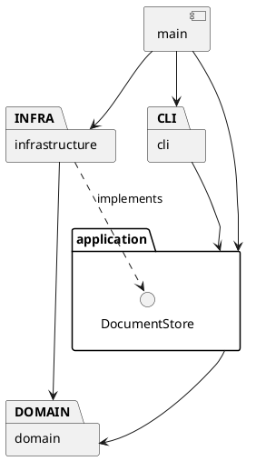

# Lab1 Phase 1：SVG 命令行编辑器

当前状态：工程初始化。本文为持续修订的架构方案，不代表功能已完成。

## 架构方案

### 模块划分

| 计划目录 | 职责 |
| --- | --- |
| src/cli | REPL、引号参数解析、命令分发与反馈 |
| src/application | 编辑器会话、命令执行、撤销重做历史 |
| src/application/commands | 各编辑命令类；一条编辑命令为一个撤销单元 |
| src/application/ports | 文档存取接口 |
| src/domain | 文档、唯一 id 索引、父子关系和树结构约束 |
| src/domain/shapes | 图形抽象、五种叶子图形与 Group |
| src/infrastructure | SVG XML 解析、序列化和文件读写 |
| src/main.ts | 程序入口和依赖组装 |

计划目录随实现创建，避免把空目录当成已实现模块。

### 设计模式的选择

- Command（必需）：编辑命令封装执行与撤销，历史管理器维护 undo/redo 栈。失败命令不入栈，不清除 redo，也不改变文档。
- Composite：叶子与 Group 提供统一操作接口，容器移动和缩放递归委托给子节点，避免命令层按图形类型分支。
- Factory：集中处理类型名到具体图形类的创建映射；SVG 导入复用工厂。
- Command 当前代码落点：
  src/application/commands/EditCommand.ts 定义命令契约；
  src/application/CommandHistory.ts 管理执行、撤销和重做；
  EditorSession 负责调用并在成功的文档操作后设置历史屏障。
  具体图形编辑命令尚待实现。
按名字分派仅允许命令分发与图形工厂两处；按实验要求列为待重构项，未来可替换为注册机制。本阶段不实现 box 或插件系统。

### 依赖方向规则

- cli 可以依赖 application；不直接操作文件系统或修改图形字段。
- application 可以依赖 domain；通过 ports 使用文档存取能力，不依赖 infrastructure。
- domain 不依赖 application、cli 或 infrastructure，不执行终端和文件 IO。
- infrastructure 可以依赖 application/ports 与 domain，实现外部存取。
- main 负责组装，可以依赖各模块。

以上规则将领域行为与输入输出隔离，便于测试和替换交互方式。

### 变化点假设

1. 交互方式可能增加 GUI 或 agent：保留 application 层供不同入口调用。
2. 图形类型可能增加：使用多态及集中工厂；暂不实现插件加载器，避免超出本阶段范围。
3. 文件存储方式可能变化：通过 DocumentStore 接口隔离。
4. 撤销实现可能优化：由命令保存恢复所需的状态；先保证精确恢复，不提前做压缩或持久化历史。

### 待确认语义

- 跨父级 group 的新组父级、插入位置及排序规则。
- 外部 SVG 的 transform 和未知标签支持范围。
- 显式 save 后，默认保存路径是否更新。
- 未初始化时 help 是否可用。
- 示例保存节点计数与实际结构不一致，需明确计数口径。

### 方案修订记录

- 2026-10-29：建立初版架构和工程骨架。

## 过程记录

### 第一步：环境检查与工程初始化

- 实际检查：工作目录为空且未初始化 Git；Git 2.41.0、Node.js 16.19.1、npm 8.19.3 可用。
- AI 协作：先阅读实验要求，明确本阶段仅实现六种内置图形，不实现 box。
- 创建严格模式 TypeScript 工程，固定编译器版本，并将构建产物和依赖目录排除于 Git。
- 遇到的问题：npm 默认缓存目录无法写入，报 EPERM。
- 解决方式：通过项目级 .npmrc 将缓存设置为 ./.npm-cache，并在 .gitignore 中忽略缓存目录。
- 验证结果：npm install、npm run check、npm run cli 均成功，入口输出工程初始化提示。

### 第二步：实现基础 REPL

- 新增 src/cli/Repl.ts，封装终端输入循环；main.ts 负责启动。
- 支持 svg> 提示符、help、忽略空行与整行注释。
- 未知命令输出 error:，随后仍可继续输入命令。
- 安装 @types/node，配置 Node.js 类型定义。
- 将 module 和 moduleResolution 统一设置为 Node16，替换旧解析模式。
- 验证结果：npm run cli 编译成功；手动测试帮助、空行、注释、
  未知命令后继续交互及退出，均符合预期。
- 当前限制：help 仅列出已实现功能，完整命令帮助将在后续补齐。

### 第三步：参数解析与错误处理

- 新增 CommandParser 类，将命令行输入解析为参数数组。
- 支持双引号包裹的空格文本、空字符串、空行和整行注释。
- 保留命令中的十六进制颜色参数，如 #ffffff。
- 未闭合的双引号抛出解析错误，由 Repl 捕获并统一添加 error: 前缀。
- help 拒绝多余参数；未知命令报错后继续交互。
- 验证结果：解析器断言检查通过；交互测试确认参数错误和引号错误后，
  help 仍能正常执行。
- 测试过程中，PowerShell 管道传递的中文提示显示为问号；
  改用英文提示后输出正常，未修改解析器逻辑。

### 第四步：画布模型与命令分发

- 新增 SvgDocument，封装画布尺寸并校验有限正数。
- 新增 EditorSession，管理当前文档；新文档校验成功后才替换旧文档。
- 新增 CommandDispatcher，集中处理命令名分发。
- Repl 负责输入输出和错误捕获，main 负责对象组装。
- 实现 init、init w h 和 canvas 尺寸查询。
- 当前约定：init 仅传宽度时，高度默认 600；未初始化时允许 help。
- 验证结果：领域模型断言检查通过；CLI 中默认尺寸、自定义尺寸、
  未初始化错误和非法初始化后的状态保留均符合预期。
- 后续进展：第五步已完成 canvas 修改尺寸；第六步已实现 init 和画布尺寸修改的历史屏障。

### 第五步：修改画布尺寸

- SvgDocument 新增 resize 方法，构造与修改共用尺寸校验。
- 先校验宽高，再统一赋值，保证修改失败不改变原尺寸。
- EditorSession 在现有文档上修改尺寸，不通过重新初始化替换文档。
- canvas 无参数时查询尺寸，修改时必须同时提供宽和高。
- 验证结果：正常修改和浮点尺寸通过；非法高度、缺少参数均报错，
  且原画布尺寸保持不变。
- 待完成：引入历史管理器后，为成功修改尺寸设置撤销重做屏障。

### 第六步：Command 接口与历史管理

- 定义 EditCommand 接口，约定 execute 和 undo 行为。
- 新增 CommandHistory，维护撤销栈、重做栈与 IO 历史屏障。
- 命令执行成功后才更新历史栈；失败编辑不清除 redo，也不解除屏障。
- 成功的新编辑清空重做栈。
- EditorSession 接入历史管理；init 和修改画布尺寸成功后清除历史并设置屏障。
- CLI 增加 undo、redo，并检查参数数量和当前文档是否存在。
- 验证结果：历史管理器独立检查通过；CLI 验证未初始化错误、
  init 后屏障和修改尺寸后的屏障均符合预期。
- 当前限制：尚无真实图形编辑命令；创建、撤销、重做的完整集成流程待下一阶段验证。

## 一致性自查

- 已实现 cli、application、domain 与 main 入口，符合计划模块划分。
- cli 通过 EditorSession 使用领域对象，没有直接导入 domain。
- application 依赖 domain；domain 不依赖 CLI 或文件系统。
- main 负责创建并连接各模块对象。
- 命令名分发已集中到 CommandDispatcher，按要求列为未来重构项。
- infrastructure、图形类和编辑命令尚未实现。

## 质量保证手段

- 当前阶段：TypeScript 严格类型检查、构建、入口启动检查。
- 后续：图形几何操作、树结构约束、命令撤销重做、失败原子性、SVG 往返测试。
- 最终：回放实验文档第 6.1 节版本 A，并在浏览器中检查保存的 SVG。
- 尚未实现的功能不记作已通过。
