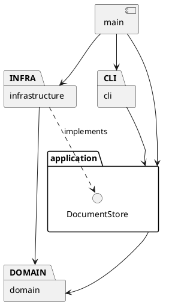

# Lab1 Phase 1：SVG 命令行编辑器

当前状态：工程初始化。本文为持续修订的架构方案，不代表功能已完成。

## 架构方案

### 模块划分

| 计划目录 | 职责 |
| --- | --- |
| src/cli | REPL、引号参数解析、命令分发与反馈 |
| src/application | 编辑器会话、命令执行、撤销重做历史 |
| src/application/commands | 各编辑命令类；一条编辑命令为一个撤销单元 |
| src/application/ports | 文档存取接口 |
| src/domain | 文档、唯一 id 索引、父子关系和树结构约束 |
| src/domain/shapes | 图形抽象、五种叶子图形与 Group |
| src/infrastructure | SVG XML 解析、序列化和文件读写 |
| src/main.ts | 程序入口和依赖组装 |

计划目录随实现创建，避免把空目录当成已实现模块。

### 设计模式的选择

- Command（必需）：编辑命令封装执行与撤销，历史管理器维护 undo/redo 栈。失败命令不入栈，不清除 redo，也不改变文档。
- Composite：叶子与 Group 提供统一操作接口，容器移动和缩放递归委托给子节点，避免命令层按图形类型分支。
- Factory：集中处理类型名到具体图形类的创建映射；SVG 导入复用工厂。

代码落点待各阶段实现后补充。按名字分派仅允许命令分发与图形工厂两处；按实验要求列为待重构项，未来可替换为注册机制。本阶段不实现 box 或插件系统。

### 依赖方向规则

- cli 可以依赖 application；不直接操作文件系统或修改图形字段。
- application 可以依赖 domain；通过 ports 使用文档存取能力，不依赖 infrastructure。
- domain 不依赖 application、cli 或 infrastructure，不执行终端和文件 IO。
- infrastructure 可以依赖 application/ports 与 domain，实现外部存取。
- main 负责组装，可以依赖各模块。

以上规则将领域行为与输入输出隔离，便于测试和替换交互方式。

### 变化点假设

1. 交互方式可能增加 GUI 或 agent：保留 application 层供不同入口调用。
2. 图形类型可能增加：使用多态及集中工厂；暂不实现插件加载器，避免超出本阶段范围。
3. 文件存储方式可能变化：通过 DocumentStore 接口隔离。
4. 撤销实现可能优化：由命令保存恢复所需的状态；先保证精确恢复，不提前做压缩或持久化历史。

### 待确认语义

- 跨父级 group 的新组父级、插入位置及排序规则。
- 外部 SVG 的 transform 和未知标签支持范围。
- 显式 save 后，默认保存路径是否更新。
- 未初始化时 help 是否可用。
- 示例保存节点计数与实际结构不一致，需明确计数口径。

### 方案修订记录

- 2026-10-29：建立初版架构和工程骨架。

## 过程记录

### 第一步：环境检查与工程初始化

- 实际检查：工作目录为空且未初始化 Git；Git 2.41.0、Node.js 16.19.1、npm 8.19.3 可用。
- AI 协作：先阅读实验要求，明确本阶段仅实现六种内置图形，不实现 box。
- 创建严格模式 TypeScript 工程，固定编译器版本，并将构建产物和依赖目录排除于 Git。
- 遇到的问题：npm 默认缓存目录无法写入，报 EPERM。
- 解决方式：通过项目级 .npmrc 将缓存设置为 ./.npm-cache，并在 .gitignore 中忽略缓存目录。
- 验证结果：npm install、npm run check、npm run cli 均成功，入口输出工程初始化提示。

## 一致性自查

- 当前仅实现 main 入口；其他模块仍为方案，尚未进行完成阶段的一致性检查。
- 当前入口没有模块间依赖；后续按实际 import 关系检查依赖方向。

## 质量保证手段

- 当前阶段：TypeScript 严格类型检查、构建、入口启动检查。
- 后续：图形几何操作、树结构约束、命令撤销重做、失败原子性、SVG 往返测试。
- 最终：回放实验文档第 6.1 节版本 A，并在浏览器中检查保存的 SVG。
- 尚未实现的功能不记作已通过。
